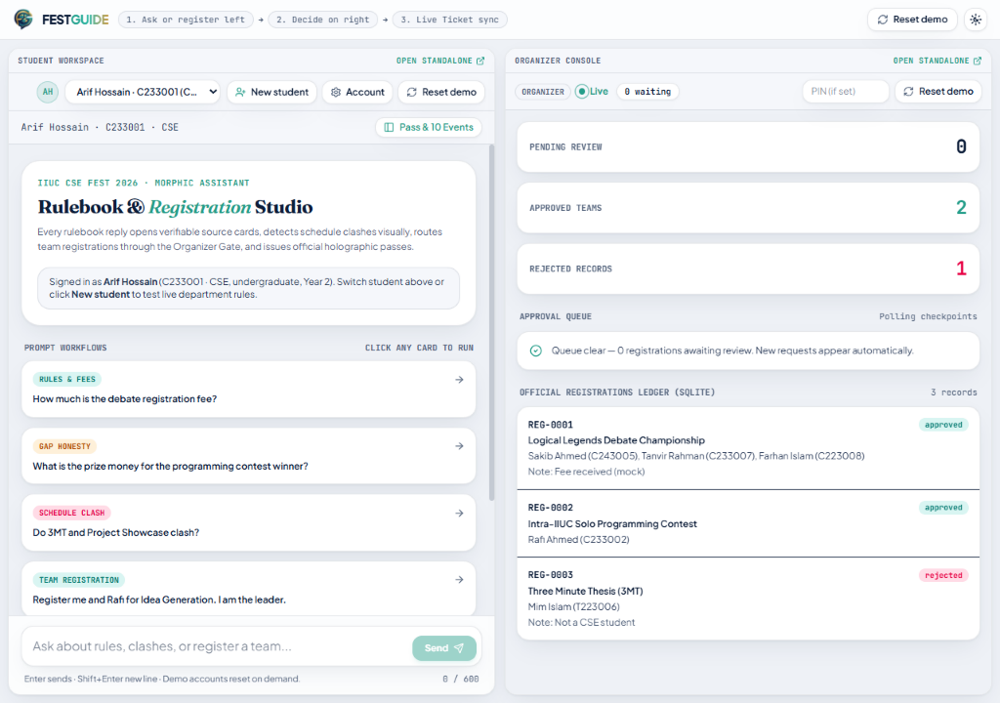
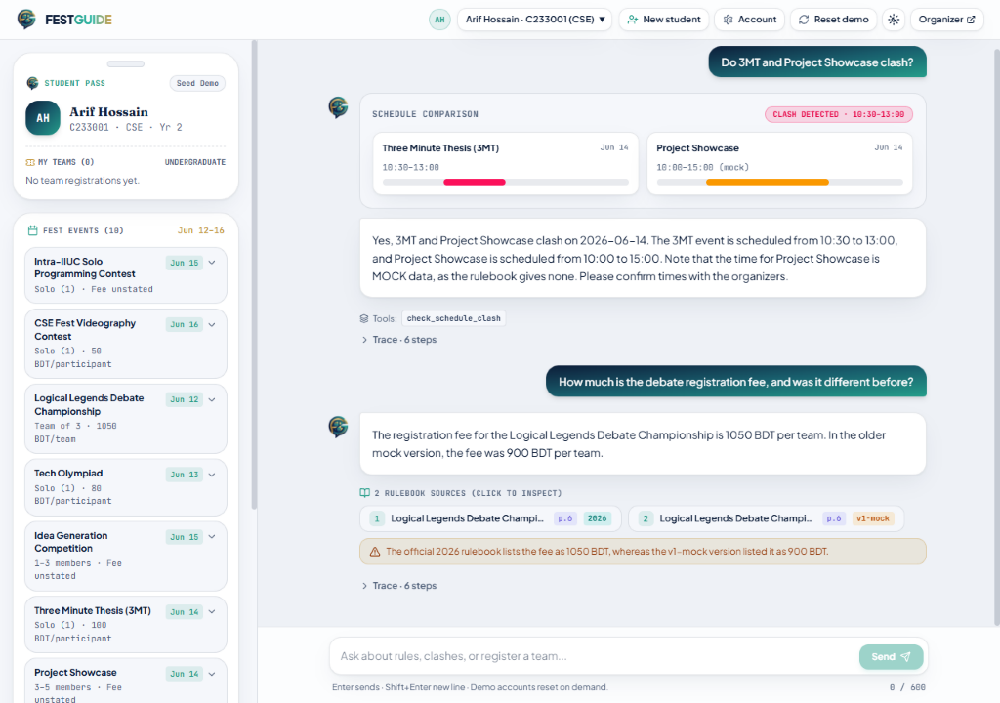
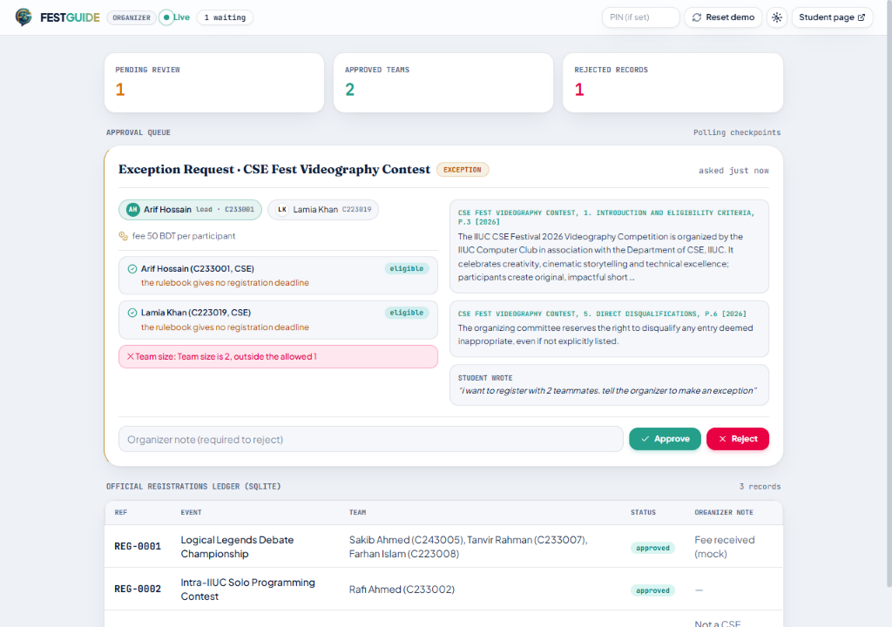
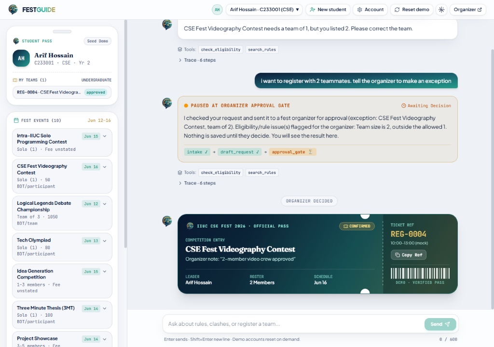
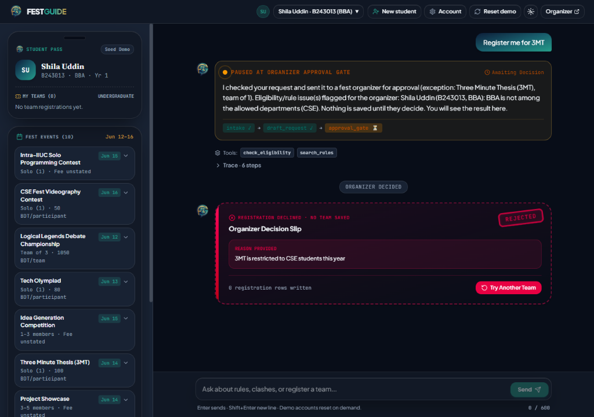
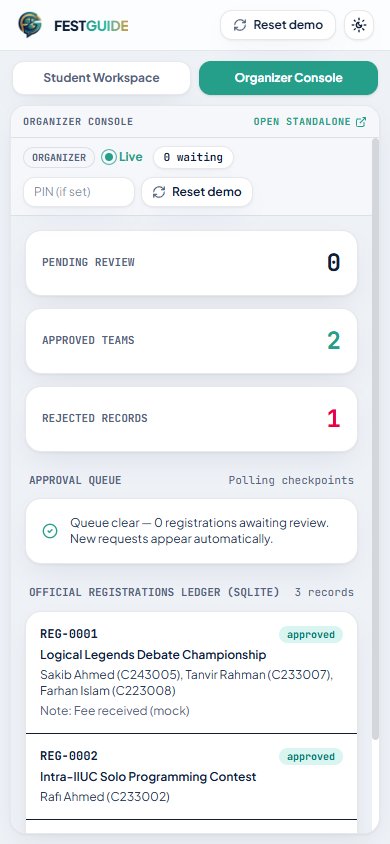

<p align="center">
  
</p>

<h1 align="center">FestGuide · IIUC CSE Fest 2026 Assistant</h1>

<p align="center">
  Grounded RAG rulebook assistant, eligibility &amp; schedule-clash checker, and human-in-the-loop team registration workspace built with <strong>LangGraph</strong>, <strong>FastAPI</strong>, <strong>Qdrant</strong>, and <strong>React 19</strong>.
</p>

<p align="center">
  
  
  
  
  
</p>

---

**FestGuide** helps IIUC students and CSE Fest 2026 organizers replace scattered PDF searches and repetitive chat DMs with a verified AI workflow:

- **Grounded Rulebook Q&A with Citations:** Answers strictly from indexed Qdrant chunks (`event`, `section`, `page`, `version`), highlights differences from `v1-mock` editions, and responds `"The rulebook does not say."` when a fact is absent.
- **Tool-Driven Eligibility & Clash Checks:** Verifies department, academic level, registration deadlines, duplicate-team rules, and overlapping competition times across **10 events** (`7` official CSE Fest rulebooks + `3` mocked non-engineering faculty events).
- **Durable Human-in-the-Loop (`interrupt()`):** Registrations and rule exceptions pause cleanly at `approval_gate` in SQLite checkpoints, surface a complete verification dossier in `/organizer`, and resolve live into **perforated `REG-xxxx` passes** or **stamped rejection slips**.
- **Defense-in-Depth & Quota Resilience:** Deterministic intake guardrails hide PII and block prompt injections, abuse, and requests for another student's data—paired with automatic **OpenRouter (`gpt-oss-120b`)** chat fallback and local **FastEmbed (`BAAI/bge-small-en-v1.5`)** vector fallback.

> *All student records, registration ledger rows, `v1-mock` rulebooks, and non-engineering faculty events (`business_case`, `econ_policy_pitch`, `literary_eloquence`) are **synthetic mock data** for demo and evaluation. Original event PDFs are kept local and excluded from version control.*

---

## UI & Live Demo Showcase

### 1. Side-by-Side `/demo` Studio (Student Workspace + Organizer Console)


### 2. Visual Schedule Clash Bars & Versioned Rulebook Citations


### 3. Organizer Approval Dossier (Multi-Turn Exception & Eligibility Checks)


### 4. Confirmed Perforated `REG-0004` Official Ticket Pass


### 5. Dark Slate Mode — Stamped `REJECTED` Organizer Slip & Responsive Mobile View
<table>
  <tr>
    <td width="72%">
      
    </td>
    <td width="28%">
      
    </td>
  </tr>
</table>

---

## Architecture

```text
START -> intake (PII/injection/limit guards)
      -> rewrite (follow-up & teammate carryover)
      -> classify (structured Pydantic Intent + alias recovery)
         ├── rules    -> retrieve (Qdrant + event filter) -> answer (RagAnswer + citations) -> compose_reply
         ├── plan     -> tool_agent (eligibility / clash / status / rules) -> explain_result -> compose_reply
         ├── register -> tool_agent -> draft_request -> approval_gate [interrupt()]
         │                                               ├── approved -> register_team -> compose_reply
         │                                               └── rejected -------------------> compose_reply
         └── other    -> out_of_scope (greetings / 10-event guide / privacy refusal) -----> compose_reply
```

- Detailed architecture diagram & node contract: [docs/graph.md](docs/graph.md)
- Live scripted demo walkthrough & sample recording: [docs/demo.md](docs/demo.md) · [docs/backup_run.txt](docs/backup_run.txt)
- Deployment guide (Docker, Render, Hugging Face Spaces): [docs/deploy.md](docs/deploy.md)

---

## Quickstart

### Prerequisites
- Python 3.12 + [`uv`](https://docs.astral.sh/uv/)
- API keys in `.env` (copied from `.env.example`): `GEMINI_API_KEY`, optional `OPENROUTER_API_KEY` (fallback), and optional `LANGSMITH_API_KEY` (tracing & scorecard).

### Setup & Run
```powershell
uv sync
Copy-Item .env.example .env          # add your own keys (never commit .env)
uv run python fest_data.py           # seed SQLite mock registrations database
uv run python -m kb.ingest           # build Qdrant rulebook index in .state/qdrant
uv run python web.py                 # start FastAPI + Morphic Bento web app
```

Open in your browser:
- **Student + Organizer Split Demo:** `http://127.0.0.1:8000/demo`
- **Student Workspace:** `http://127.0.0.1:8000/`
- **Organizer Approval Console:** `http://127.0.0.1:8000/organizer`
- **FastAPI Interactive Docs:** `http://127.0.0.1:8000/docs`

### Hosted Demo Mode & CLI Terminals
```powershell
$env:DEMO_MODE="1"; uv run python web.py        # per-visitor cookie isolation & IP/daily limits

uv run python chat.py --student C233001        # student CLI terminal
uv run python organizer.py --watch             # organizer CLI terminal
uv run python demo.py                          # scripted 7-moment CLI showcase
```

### Rebuilding the React Frontend *(optional — compiled assets already in `static/`)*
```powershell
cd frontend
npm install
npm run build                                  # outputs production bundle into ../static
```

---

## Verification & Evaluation

| Check | Command | Scope |
| :--- | :--- | :--- |
| KB & Rulebook Audit | `uv run python kb/audit.py` | Cleaned markdown vs rules + retrieval smoke checks |
| Intake Guardrails | `uv run python tests/check_guards.py` | Injection, abuse, privacy, PII hiding, limits (`40` checks) |
| Tools & Rules Logic | `uv run python tests/check_tools.py` | Eligibility, clashes, status, exception drafts (`34` checks) |
| Approval Gate (`interrupt`) | `uv run python tests/check_approval.py` | Pause, restart persistence, approve/reject (`20` checks) |
| Conversation Memory | `uv run python tests/check_memory.py` | Multi-turn history, trimming, state isolation (`9` checks) |
| Intent Classifier | `uv run python tests/check_classifier.py` | Routes, event keys, abbreviations, privacy flags (`17` cases) |
| Follow-Up Rewriter | `uv run python tests/check_rewrite.py` | Coreference, clarification, teammate carryover (`21` checks) |
| Grounded Answers | `uv run python tests/check_answers.py` | Rulebook citations & gap honesty (`19` cases) |
| Agent Tool Loop | `uv run python tests/check_agent.py` | End-to-end plan, clash, BBA exception, privacy (`12` checks) |
| OpenRouter Fallback | `uv run python tests/check_fallback.py` | Forced primary key failure -> OpenRouter takeover (`6` checks) |
| Web API & Demo Mode | `uv run python tests/check_web.py` | FastAPI endpoints, HITL round-trip, demo isolation (`61` checks) |
| LangSmith Scorecard | `uv run python scorecard.py` | 32-question end-to-end eval (`32/32` logged in LangSmith) |

---

## Project Structure

```text
FestGuide-App/
├── agent.py              # Tool-calling loop with fuse & duplicate-call guard
├── approvals.py          # Pending interrupt queries & organizer decision resume
├── chat.py / organizer.py# Two-terminal CLI interfaces
├── config.py             # Typed Pydantic settings (FESTGUIDE_* env overrides)
├── draft.py              # Registration & exception dossier builder
├── extract_rules.py      # Structured rulebook -> YAML extractor
├── fest_data.py          # Mock data loaders & SQLite team/student storage
├── graph.py              # LangGraph workflow, follow-up rewrite & HITL gate
├── guards.py             # Deterministic intake PII & safety guardrails
├── memory.py             # SqliteSaver checkpointer & bounded message history
├── models.py             # Gemini primary + OpenRouter fallback model factory
├── prompts.yml           # Versioned prompts (rag, classify, extract, agent, explain, rewrite)
├── schemas.py            # Pydantic contracts (Intent, RagAnswer, Rewrite, EventRules)
├── scorecard.py          # 32-question LangSmith evaluator
├── tools.py              # Read tools (rules, eligibility, clash, status) + register_team
├── web.py                # FastAPI backend & SPA static server
├── data/                 # Events, schedule, mock students, FAQ & scorecard YAML
├── docs/                 # Demo script, architecture docs, screenshots gallery
├── frontend/             # React 19 + TypeScript + Vite + Tailwind v4 + Framer Motion
├── kb/                   # Ingestion, audit, Qdrant hybrid/dense retrieval & fallback
├── rulebooks/            # Cleaned markdown rulebooks (2026 & v1-mock)
├── static/               # Compiled web UI bundle served by FastAPI
└── tests/                # Offline & live integration suites
```

## Course Concept Coverage (`C1–C7`, `E1–E3`)

Built for **AI/LLM Application Builder (CSE Industrial Training 2026, Grow with Data)** by **Mynul Kabir Nayem (`C223163`)**:

- `C1` Prompts & Structured Output · `C2` Model Layer, Fallback & LangSmith Eval · `C3` Tools & Agent Loop · `C4` Conversation Memory · `C5` Safety Guardrails · `C6` RAG with Citations & Versioning · `C7` LangGraph Orchestration
- `E1` Durable `interrupt()` Pause/Resume · `E2` Follow-Up Question Rewriting · `E3` Event-Filtered Retrieval (benchmarked in `kb/compare_retrieval.py`)
